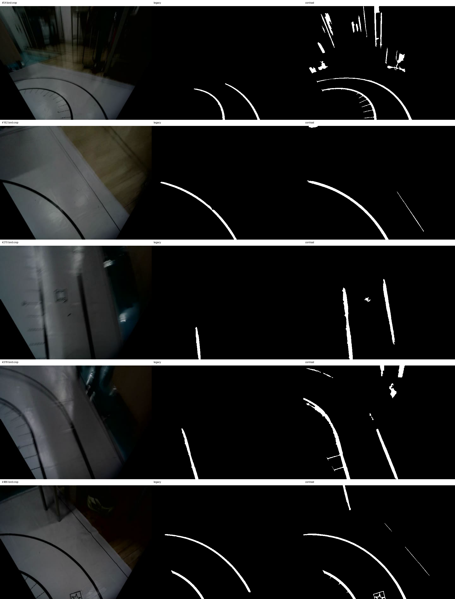

# `camera_commands.avi` 巡线二值对照

原视频：`Robocup/camera_commands.avi`。选取第 54、162、270、378、486 帧；每帧尺寸 960×468。左、右各 480 px；底部 110 px 是命令字幕，已去除。左半为录像中的原 BGR 鸟瞰图，右半是当时已生成的二值图，本实验**没有把右半作为输入**。每帧有单独的 `frame_XXXX_compare.png`，原鸟瞰及两张二值结果也分别保存为 `frame_XXXX_bird/legacy/contrast.png`。

主对照 `overview_raw.png`：将裁得的 480×358 左半图恢复到当前鸟瞰工作尺寸 623×466，取 `max(B,G,R)`；不做额外光度匹配。分别运行现有 `extract_lane_candidates()` 的 `legacy` 和 `contrast`，参数固定为 `th_offset=-12`、`th_min=25`、`th_max=80`、`adaptive_c=-12`，两边使用同一份当前几何的有效地面 mask。白色是**巡线候选**，还不是最终选中的左右边线。

辅助对照 [overview_lut.png](overview_lut.png) 仅在两种预处理之前共同加上当前 `lut_max` 光度映射，用来检查结论是否依赖这一步。它仍不是当时视频的原始运行输出。阈值、连通域数和白像素数见 [metrics.csv](metrics.csv)。

肉眼可见，第 270、378 帧 `legacy` 丢了原图中的一条可见边线，`contrast` 留下两条；第 54 帧 `contrast` 同时把上方器材和场外细纹大量提白。五帧里 `legacy` 各保留 1–2 个连通域，`contrast` 各保留 3–18 个。因此这里展示的是**召回和误候选之间的取舍**，不能只用“白色越多”判断好坏。后续横行宽度筛选、双线配对和跟踪锁还会再筛一次。

限制：录像经过 MJPG 编码，并把原鸟瞰缩为 480×358；回放时再放大不能恢复丢失的细节。当前 mask 和工作尺寸来自本地代码，可能与录像时的版本有细微差异。本图适合直观看两种预处理的差异，不是实车跑线成功率测量；此处没有调整生产参数或控制逻辑。
