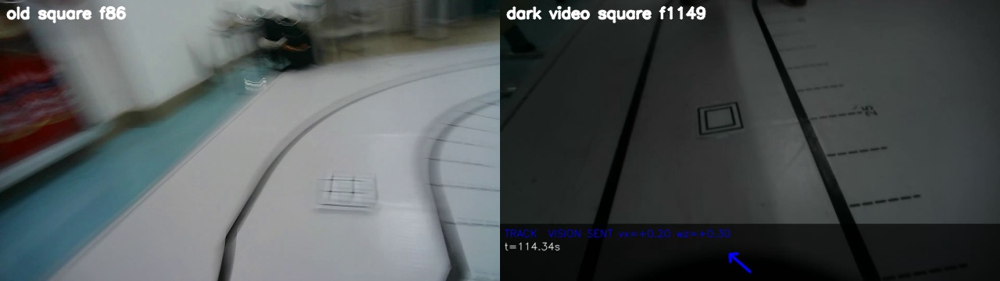

# 现有视频中的图卡：停车与停后分类分开看

本轮只回放既有照片、视频和日志，没有连接电机。比赛流程保持为：**远处看见图卡 → 接近触发线 → 停车 → 发送 7 并等低头完成 → 静置 0.1 s → 多帧分类投票 → 发 1–6**。起点第一张卡的锁存特例仍按现有代码运行。

## 看了什么

- 旧的 `Robocup/6card` 六类实拍 31 张，加仓库里一张较暗方卡照片，用于静态精准识别。
- `reviewed_annotations.json` 的 9 段有卡遭遇、7 段无卡区间：每 3 个保存视频帧调用一次检测，共 80 次有卡调用、167 次无卡调用。所有有卡采样帧的粗框 ROI 都有人眼标注；相邻帧有关联，不是 80 次独立试验。
- 加工视频 `camera_commands3.avi` 的新方卡、新圆卡、线缆负例，以及旧星形运动视频，已按时间剪成四段，见 [video_replay](video_replay/)。裁剪只截时间，不裁空间，避免改变宽度与距离判断。原视频带 HUD/字幕，不能当作未处理的固定曝光相机原图。
- 2026-10-10 21:10:13 那趟已拉取的实车 `line_frames.jsonl` 与主程序日志，用于核对真实停车窗口是否有读卡调用。

这两帧的视角、模糊程度和拍摄阶段不同。旧方卡帧的上部有效画面灰度均值/标准差约 `116/46.5`，较暗视频帧约 `50.5/19.0`；卡片粗 ROI 的 `p90-p10` 分别为 27、33。它们说明两批画面的光度范围差异很大，但**不能**据此断言新画面上的卡片局部结构一定更差。数据在 [old_new_frame_stats.csv](video_replay/old_new_frame_stats.csv)。

## 第一段：运动中看见卡并停下

当前代码先用精准框或模糊存在信号确认有卡；有精准框时按框宽判断是否到 `--card-trigger-dist-cm`，否则退回框中心 `cy`。`card_flag` 对偶发漏帧有 4 次调用的滞留，停车另受 `card_armed`、首卡锁和 `card_triggered` 控制。默认触发距离目前为 **43 cm**；历史命令指定过 **30 cm**，不能混算。

在 43 cm 门槛的离线近似回放中，现有图像匹配 + selective 模式：**9 段有卡遭遇中 8 段出现潜在停车触发，7 段无卡区间 0 段触发**。唯一没出现的有卡段是 `new_circle_restart`，4 次采样都没有匹配真实卡的存在框。80 次有卡调用中只有 33 次有匹配位置的 presence，说明位置时断时续；时间窗和连续远近观测仍重要。30 cm 门槛为 6/9，但两段视频在到达门槛前结束，不能把它们算作“跑过卡”。

这里的“潜在触发”只在保存视频上重放 `presence/card_flag`、框宽优先和 `cy` 兜底；每段重置状态且以普通入口初始 `card_armed=True` 开始。它**没有**同步真实步态、首卡门控、发送 7、STM32 完成事件，也没有测停下后的实际厘米数。因此能说现有触发信息常常足够，不能说 8/9 次实车都准确停在 43 cm。逐段的触发帧、位置来源、ROI 匹配在 [episode_stage.csv](video_replay/episode_stage.csv)。

## 第二段：停稳后是否真的有票、票是否正确

在上述**运动视频**的 80 次有卡调用里，只有 5 次既找到匹配真实卡的精准框又判对类别，分布在 2 段视频中；0 次跨类错。这个数解释“运动时精准识别很少”，**不等于停车后的正确率**。旧31张静态实拍里，现有图像匹配 + selective 找到框 28 张，判对 27 张，0 张跨类错；一张较暗方卡照片三种光度模式均判对。31张来自旧条件，属于已反复开发使用的样本。

更直接的实车证据是 21:10:13 那趟方卡：遥测第 128 帧进入停车窗口，之后第 129–143 帧约 3 秒里 `shape_update_ms` 全为空；第 144 帧窗口已关闭，才再次有图卡检测调用，主程序没有该卡的 1–6 事件。日志缺少每帧的低头完成/等待原因，不能断言是哪一道状态闸造成；但可以确定**这次没有停后分类样本，分类器本身无从发挥**。同趟后面另一张卡的窗口在第 300、302、304 帧有检测调用，并最终发了动作 2，说明问题具有时序性。

## 光度模式的同帧对照

| 模式（同一16段视频） | 有卡位置匹配/80调用 | 精准判对/80调用 | 精准错类 | 43 cm 潜在触发/9段 | 无卡潜在触发/7段 |
|---|---:|---:|---:|---:|---:|
| 当前整图匹配 + selective | 33 | 5 | 0 | 8 | 0 |
| 原图 + selective | 22 | 5 | 0 | 6 | 0 |
| 只调阈值 + selective | 33 | 6 | 0 | 8 | 0 |
| 原图 + 局部暗度找框候选 | 27 | 10 | **5** | 7 | 0 |

数据见 [mode_summary.csv](video_replay/mode_summary.csv) 与逐帧 [replay](video_replay/replay/)。只调阈值比当前模式多一帧正确分类，来自相关视频帧，不能当成独立增益。局部暗度虽然多找到框，也新增 5 次跨类错，现阶段不适合作为动作依据。当前图像匹配没有在这些加工视频上输掉停车触发，因此不能仅凭旧31张照片就关闭它。

## 建议的下一步

1. **先补齐停后时序证据。** 在现有日志里持续核对每次停车的 `7` 发送、STM32 `DONE`、0.1 s 静置到期、实际 `ShapeDetector.update` 调用数和每类票数。那趟方卡窗口“0 个停后调用”应先定位，不能用分类参数修。
2. **保持两段任务分离。** 行走中只要求有卡、位置和远近；停稳后才把完整四边形、矫正后的内部图形送入六类投票。模糊存在信号不得直接给类别或动作。
3. **不要把整图亮度拉回旧值当目标。** 未来可在同帧离线比较现有匹配与“只调阈值”，分开统计近距框是否成立、局部笔画是否连通、错类与拒识；已有新暗视频有 HUD，报告必须保留这一限制。固定曝光的过渡应平滑地改变局部判据，而不强行改动原 BGR 的颜色和外观。
4. **当前不改实车默认或分类分界。** 停车距离和采样时序还缺对应真实地面测量；有大量旧数据可继续复用，但不能把离线潜在触发写成物理停车精度。
