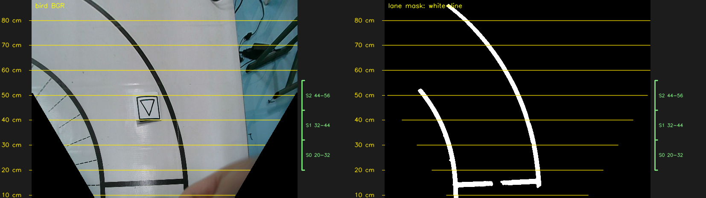

# 鸟瞰每 10 cm 标尺

同一张旧实拍 `Robocup/6card/三1.jpg`，按当前 `usb_main` 相机配置缩到 1280×720，再走现有鸟瞰和巡线二值化。未改投影矩阵或巡线参数。左图是鸟瞰 BGR，右图是巡线候选二值图（白色表示候选线；黑角是未观测地面）。

单图：[鸟瞰 BGR](bird_color_10cm.png) · [二值图](bird_binary_10cm.png) · [逐行数值](distance_grid.json)。图片可由 `scripts/render_bird_distance_grid.py` 离线重建。

## 距离从哪里算

这里的 `z=0` 是**相机光心正下方的地面点**，不是画面底边，也不是机器人的脚/躯干中心。`cameras.json` 的距离校正为 `z_true = 1.13233 × z_model − 2.4862`。现有鸟瞰为 **623×466**，纵向每行约 **0.170275 cm**；最上行约 **88.10 cm**，最下行约 **8.92 cm**。因此图上 `10 cm` 几乎贴着底边。当前代码没有相机地面原点到机器人参考点的已测平移量，不能把标尺直接称为“机器人前方 10 cm”。

| 相机地面原点前方 | 鸟瞰行 y（上方是 0） |
|---:|---:|
| 10 cm | 459 |
| 20 cm | 400 |
| 30 cm | 341 |
| 40 cm | 282 |
| 50 cm | 224 |
| 60 cm | 165 |
| 70 cm | 106 |
| 80 cm | 48 |

绿色括号是当前 `run_policy_vision.py` 未覆盖参数时的 `segments` 三段：**S0=20–32 cm（约 y=400–330）**、**S1=32–44 cm（约 y=330–259）**、**S2=44–56 cm（约 y=259–189）**。这些是观测赛道的地面范围；控制器最终能否使用 S1/S2 还取决于配对、连续性和残差检查。`--heading-lookahead-cm 50` 是前方目标距离，不表示只在第 224 行取一个点。

`heading` 是另一套近、远观测带。当前 CLI 未显式设置 `--heading-regions-cm` 时，近带约为 **20.16–25.95 cm**，远带围绕 `--heading-far-cm 29`，约为 **27.82–30.21 cm**；`config/button_start.env.example` 则示范显式设置近带 `24–26 cm`、远带 `28–30 cm`。实车实际值以当趟命令、环境变量及启动日志为准。

黄色线在未观测黑角处中断，因为这些角不是实际看到的地面。20–75 cm 是相机距离线性校正所用照片的量程；图上的 10 cm 和 80 cm 为模型外推，运动俯仰和安装位置也会造成实物误差。此前所说“机器人位置在画面底边后约 15 cm”尚不是代码中的标定量，本图未擅自加这个偏移。
